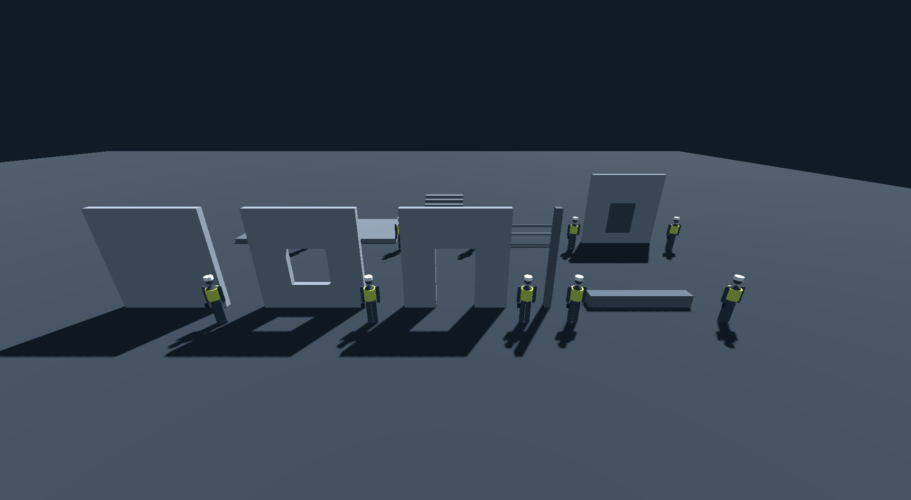
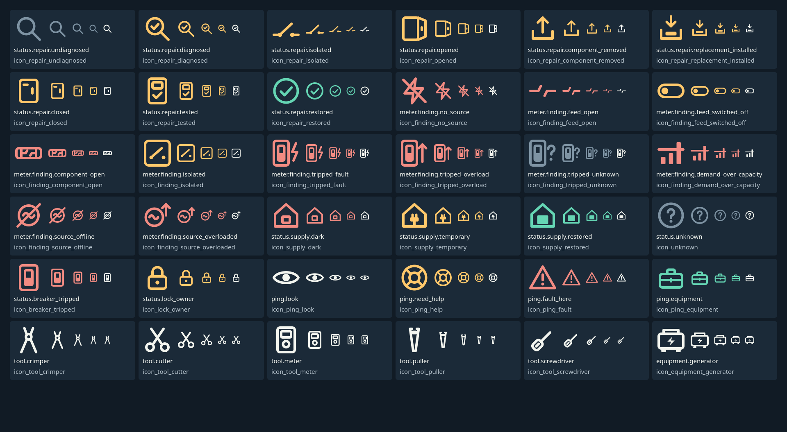
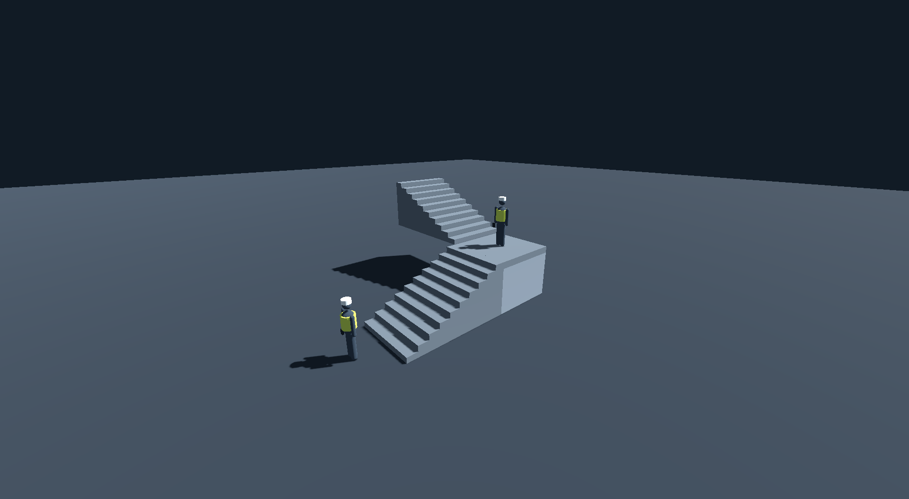

# Evidence: F05 Establish visual tokens and block kit (cloud part: data only)

- Status claimed: CLOUD_VERIFIED (cloud part only; the kit, worker silhouette and editor import check are local art work)
- Date (UTC): 2026-10-29
- Branch / commit: `claude/F05-tokens-data` (see PR)
- Environment: cloud (Linux x86_64, headless); CI reruns on Linux and Windows runners
- Engine: Godot 4.7.2.stable.official.ed1daf0bf. No font, model, image or third-party asset added (stop-and-ask item).

## Acceptance criterion (copied from docs/backlog.json)
> Kit imports at 1 unit per meter; HUD tokens match screen specification.

## What was built (cloud part)
- `content/ui/tokens.json`: blueprint p.11 colors, type sizes (22/26/32-44 px), 48 px targets, 80 px safe area, UI scale 80-150 %, contrast rules.
- `content/ui/status_states.json`: one icon id + text key + token color per real state (9 repair states, 11 meter findings, 3 supply states,
  unknown, breaker tripped, lock owner). Icons are named, not drawn.
- `content/world/kit_dimensions.json`: 4 m module, 0.25 m increments, panels 1.2-1.6 m, 2.4 m circulation, 1.1 m doors, 1.75 m camera, 2.3 m ray.
- `scripts/ui/theme_tokens.gd`: Theme from tokens (font colors and sizes, opaque panel, amber focus border for the controller focus path).
- `tools/check_contrast.py` in `tools/run_tests.sh`; ADR-004 addendum with the measured findings.

## What was run
`bash tools/run_tests.sh` -> exit 0. Negative control: panel opacity 92 % -> `contrast: 44 checks, 2 failures`, CHECKS FAILED; reverted.

## Observed result
- Contrast: 44 checks, 0 failures at the chosen opaque panels (see ADR-004 addendum for the two pairs that fail when translucent).
- tests/unit/test_F05_tokens.gd, 5 tests PASS: tokens equal the blueprint values; icon list = code states both ways, each with a text key and a token
  color, icons unique; FINDING_CODES equals the codes meter_model.gd emits; theme builds with the token values; kit/interaction dimensions agree.
- Totals: Godot `tests: 107 passed, 0 failed, 2355 assertions`.

## Not verified / pending_local
- "Kit imports at 1 unit per meter": no kit exists; modelling and the editor import check are local (blueprint pipeline p.41, licensing first).
- Worker silhouette, icon artwork, font choice (owner approval + license record), rendered contrast on real screenshots (translucency, bloom, rain).
- HUD layout against the 1920x1080 references (V07).

## Local part 1: graybox block kit and worker silhouette (30 Oct 2026, desktop session)

- Branch: `claude/F05-blockout-kit`, cut from `main` at 615923f (see PR). Status stays **CLOUD_VERIFIED**: font, icon art, rendered HUD contrast
  and the owner's silhouette/scale approval are still open.
- Environment: owner's Windows 11 laptop, NVIDIA GeForce GTX 1650 (driver 595.79), Git Bash, Godot 4.7.2.stable.official.ed1daf0bf
  (Compatibility renderer, OpenGL 3.3). No font, model, image or third-party asset added; every mesh is a Godot primitive.

### What was built
- `content/world/kit_pieces.json`: the ten pieces named on blueprint p.11 (wall, window wall, door wall, corner, roof edge, roof plane, floor,
  stair flight, railing, service panel recess) plus the worker silhouette, as integer-centimeter parts, collision, and anchors
  (`WindowLight`, `Doorway`, stair `Bottom`/`Top`, `PanelAnchor`, worker `Eye`).
- `scripts/world/kit_builder.gd`: data to scene (cm to m in one place), plus `mesh_bounds()` and `describe()` for checks.
- `tools/godot/build_blockout_kit.gd`: writes `scenes/kit/*.tscn` and `scenes/actors/worker_silhouette.tscn`. Output is byte-identical
  on rerun: it keeps each scene UID and derives node `unique_id`s from the node path, because Godot 4.7 randomizes them on every save.
- `tools/godot/capture_kit_lineup.gd`: renders the kit with a worker in front of every piece on the real GPU (not headless, not CI).
- Collision is simplified per blueprint p.40 PRP05/ENV01: boxes, one box per railing, and a single ramp for the stair flight (no step snags).

### What was run
```
G=/c/Tools/Godot/Godot_v4.7.2-stable_win64_console.exe
"$G" --headless --path . -s "$PWD/tools/godot/build_blockout_kit.gd"        # 11 x WROTE; rerun -> md5 of all 11 files unchanged
"$G" --path . --resolution 1920x1080 -s "$PWD/tools/godot/capture_kit_lineup.gd" -- --out=build/kit_lineup.png
GODOT_BIN=$G PYTHON=py bash tools/run_tests.sh
```
Negative control: wall height 400 -> 390 cm in the data without regenerating -> `test_F05_committed_scenes_match_the_data` FAIL; reverted.

### Observed result
- `tests: 177 passed, 0 failed, 3486 assertions`, content 18 files / 0 errors, contrast 44/0, reference 19 OK, `SOLVED C01`, `MATCH`,
  `ALL CHECKS PASSED`.
- `tests/unit/test_F05_kit.gd`, 8 tests PASS. They check that the 4 m wall measures `AABB((0,0,0),(4,4,0.25))`, so **1 unit = 1 m**. Every committed
  scene matches the data and its envelope. Module pieces span one 400 cm module. The door clears 150 cm (minimum 110). The stair is 250 cm wide (circulation 240) at 26.6 degrees.
  The panel anchor sits at 150 cm (range 120-160) and can be reached with the 230 cm ray. The worker's eye is at 175 cm, the camera height.
- Render: `WROTE build/kit_lineup.png (1920x1055, NVIDIA GeForce GTX 1650)`, copied to `docs/evidence/img/F05_kit_lineup.png`.
  The worker (188 cm to the helmet top) stands about half a storey tall. Openings, stairs, rails and the panel recess read at street distance.



### Owner approval
- **30 Oct 2026: the owner (Levon) approved the kit scale and worker silhouette** from `img/F05_kit_lineup.png` in the desktop session
  (blueprint p.41 pipeline step 3, "Approve silhouette and scale"). The approval covers the blockout only; final geometry gets its own check.

### Not verified / still pending
- Blueprint p.40 ENV01 counts **11** kit pieces; p.11 names 10. No 11th piece was invented. The owner decides whether it exists (for example a door/window with a frame, or a stair landing).
- Native `.tscn` blockout has no import step. The glTF import check at 1 unit = 1 m applies when final geometry arrives (pipeline steps 4-6, licensing first).
- Owner-approved licensed font (blueprint suggests Noto Sans; stop-and-ask), icon art for `status_states.json` (UI02: SVG, 24/32/48 px),
  and contrast on a rendered HUD over the scene (with V07).
- Walkability on the stair and through the door with a real CharacterBody3D comes in V01, with controller traversal.

## Local part 2: UI02 status, tool and ping icons (30 Oct 2026, desktop session)

- Branch: `claude/F05-status-icons`, cut from `main` at cbd14a2 (PR #30). Status stays **CLOUD_VERIFIED**: the font, the 11th kit piece and
  rendered HUD contrast (V07) are still open. The owner approved the icon set (see "Owner approval" below).
- Environment: owner's Windows 11 laptop, NVIDIA GeForce GTX 1650, Git Bash, Godot 4.7.2.stable.official.ed1daf0bf. No font, icon pack, image
  or third-party asset added. The icons are original work drawn for this project; the asset record is in the ADR-004 addendum.

### What was built
- **36 icons**, one per entry in `content/ui/status_states.json`: 9 repair states, 11 meter findings, 3 supply states, unknown, breaker
  tripped, lock owner, 4 pings, and the 5 tools plus 1 equipment kind that C01 content actually uses. Two new groups, `tools` and `equipment`, cover them.
  A test fails if a contract names a tool or equipment kind that has no icon, or if an icon names a tool that no contract uses.
  Blueprint UI02 counts 24 icon families. The real state lists need 36, and ADR-004 point 2 (one icon per real state) takes precedence.
- **Sources:** `art_source/ui_icons/<icon>.svg`, hand-written SVG on a 24 px canvas, white ink only, 2 px stroke, rounded caps and joins,
  and no text, scripts or external references. These files are not in LFS: `.gitattributes` exempts them so they stay diffable and the tests run on a clone
  without LFS.
- **Exports:** `assets/ui/icons/<24|32|48>/<icon>.png` (+ committed `.import`, lossless, no mipmaps), written by
  `tools/godot/export_icons.gd`. It rewrites a file only when its pixels change; a rerun reports `0 wrote, 108 unchanged`.
- **`scripts/ui/icon_raster.gd`:** the icon list, paths and SVG rasterization, shared by the exporter and the tests.
  It also has `export_px_for_scale()`, which picks the export for a UI scale (80-100 % -> 24 px, up to 133 % -> 32 px, up to 150 % -> 48 px).
- **Tinting:** the HUD tints icons with the state's token color (`self_modulate`), so color never lives in the art. Every status still shows
  its text key next to the icon.
- **Review sheet:** `tools/godot/capture_icon_sheet.gd` renders each icon on the opaque panel. Each icon is shown five times: a 72 px view of the source, the
  48/32/24 px exports in the token color, and the 24 px export in plain text color.

### What was run
```
G=/c/Tools/Godot/Godot_v4.7.2-stable_win64_console.exe
"$G" --headless --path . -s "$PWD/tools/godot/export_icons.gd"     # icons: 108 wrote; rerun after the last edit: 0 wrote, 108 unchanged
"$G" --headless --path . --import
/c/Tools/Godot/Godot_v4.7.2-stable_win64.exe --path . --resolution 1920x1080 -s "$PWD/tools/godot/capture_icon_sheet.gd" -- --out=build/icon_sheet.png
bash tools/run_tests.sh
```
Negative controls (each reverted, then the suite passed again):
1. Change one SVG without re-exporting. `test_F05_committed_exports_match_their_svg_source` FAILS.
2. Draw `icon_repair_tested` with the meter dial instead of the check. The distinct-silhouettes test FAILS (and so does the export check).
3. Bake a coral stroke into `icon_unknown.svg`. The family-rules test FAILS (and so does the export check).

### Observed result
- `tests/unit/test_F05_icons.gd`, 7 tests PASS:
  - every icon has one source and three exports, and nothing else exists;
  - the tools and equipment groups match the C01 content;
  - every source follows the family rules;
  - the exports match a fresh rasterization (within 2/255 per channel);
  - ink coverage is 6-50 % with a 1 px clear margin (measured 8.6-42.4 %);
  - silhouettes are distinct without color;
  - each UI scale maps to the right export.
  `test_F05_tokens.gd` now also checks color, text and uniqueness for the tool and equipment entries.
- Distinct without color: every pair of 24 px icons differs in at least 16 strongly inked pixels (more than half coverage). The closest pairs are by
  design, a shared base plus a different detail:
  - undiagnosed vs diagnosed: 20 px (magnifier, with or without the check);
  - tested vs meter tool: 21 px;
  - supply dark vs restored: 23 px (empty window vs lit window);
  - the three tripped findings: 28-39 px (breaker + spark / up arrow / `?`).
- `bash tools/run_tests.sh`: `tests: 187 passed, 0 failed, 4943 assertions`, content 18/0, contrast 44/0, reference 19 OK, `SOLVED C01`, `MATCH`,
  `ALL CHECKS PASSED`.
- Render: `WROTE build/icon_sheet.png (1920x1055, NVIDIA GeForce GTX 1650)`, copied to `docs/evidence/img/F05_icon_sheet.png`.



### Owner approval
- **30 Oct 2026: the owner (Levon) approved the UI02 icon set** from `img/F05_icon_sheet.png` in the desktop session (blueprint p.41
  pipeline step 3). The approval covers the 36 icons at commit e5ab01e; a later change to an icon needs a fresh look.

### Not verified / still pending
- Contrast was checked on the opaque token panels only (`check_contrast.py`: every token color used as an icon color passes 3:1 on panel,
  elevated and background). Contrast over the rendered 3D scene comes with V07.
- No HUD uses the icons yet (V07). Platform input glyphs (ADR-004 point 3) are a separate set, not part of UI02 status icons.

## Local part 3: UI font, Noto Sans (30 Oct 2026, desktop session)

- **The owner chose Noto Sans** (30 Oct 2026, in the desktop session; blueprint p.11 suggests it). The branch is the same as part 2 (PR #30).
  Status stays **CLOUD_VERIFIED**: the 11th kit piece and the V07 contrast check are still open.
- Environment: same PC and Godot build as part 2.

### What was added
- `assets/fonts/noto_sans/NotoSans-Variable.ttf`: Noto Sans v2.015, the upright variable font (`wdth`, `wght`), 2,049,096 bytes. Its original name is
  `NotoSans[wdth,wght].ttf`. `OFL.txt` (4,396 bytes) sits next to it.
  - Source: google/fonts at commit 8b0a1d0f5983c89bc2b93f1b5fb55f9e252744b5, `ofl/notosans/`. Upstream is notofonts/latin-greek-cyrillic at c4a321e.
  - The files were downloaded with curl from raw.githubusercontent.com at that commit into an empty scratch folder. Before copying, `git hash-object` gave the
    same blob hashes GitHub's API lists (`75575046…`, `6843f318…`). SHA-256 is `bfb7bb69…6b3d`.
- `content/ui/tokens.json` `font`: family, path, license (OFL-1.1), license file, version, source and upstream URLs, SHA-256, and weights (body 400,
  buttons and headings 600).
- `scripts/ui/theme_tokens.gd`: the theme's default font is the variable font at weight 400, and `Button`, `HeaderLarge` and `HeaderMedium` use it at 600
  (one file, `FontVariation`). The header types are declared as Label variations so the weight applies.
- ADR-004 addendum "UI font": the asset record, the OFL release obligations (ship `OFL.txt`, which the R checklist checks), and the open point that Simplified Chinese
  needs Noto Sans SC later.
- The review sheet is rendered with the token theme, so its labels are now Noto Sans. It was re-captured on the GTX 1650 into `img/F05_icon_sheet.png`.

### What was run and observed
- `test_F05_font_is_the_recorded_licensed_noto_sans` PASS. It checks:
  - the committed file's SHA-256 equals the record;
  - the license is OFL 1.1 and its text is present;
  - the theme font's family is "Noto Sans", at weight 400 for body and 600 for buttons and headings;
  - glyphs exist for Latin UI text, `?`, and pseudo-locale accents (`ÀÉÎÕÜçñßØå`).
- Negative control: one changed hex digit in the recorded SHA-256 makes the test FAIL. Reverted.
- The first headless `--import` of the font took over a minute; later runs reuse `.godot/` and are fast.

### Not verified / still pending
- Simplified Chinese glyphs: Noto Sans does not cover CJK. The fallback (Noto Sans SC) waits for the localization task and the owner's go-ahead,
  because of its size.
- The 35 % pseudo-locale layout test and text over the rendered scene come with V07. No game screen uses the theme yet.

## Local part 4: 11th kit piece, the stair landing (30 Oct 2026, desktop session)

- **The owner decided the 11th ENV01 piece is a stair landing** (30 Oct 2026, in the desktop session). Blueprint p.40 counts 11 pieces; p.11 names 10.
  The branch is the same as parts 2-3 (PR #30). Status stays **CLOUD_VERIFIED**: the only open item is the V07 contrast check.
- Environment: same PC, GPU and Godot build as part 2.

### What was built
- `content/world/kit_pieces.json` `stair_landing`, 250 x 200 x 250 cm:
  - the walking surface is at one flight's rise (200 cm), and the landing is as wide and as deep as a flight;
  - so two flights make one 4 m storey: straight on, as an L turn, or as a U turn with two landings side by side;
  - parts are a 25 cm floor slab over a support block;
  - collision is one box (no seams under the feet);
  - anchors are `EdgeNear`/`EdgeFar`/`EdgeLeft`/`EdgeRight` at the walking surface.
  
  It is solid below because the 175 cm underside is lower than a worker (188 cm).
- `scenes/kit/stair_landing.tscn`, generated by `tools/godot/build_blockout_kit.gd`. The other 11 scenes regenerated byte-identical, and a rerun
  gives the same md5 for the new scene (`7c7b5e8d…`).
- `tools/godot/capture_kit_lineup.gd --stairs` renders flight -> landing -> flight (an L turn), placed only by the pieces' anchors, with one worker at the
  foot and one on the landing.
- `tests/unit/test_F05_kit.gd`: the blueprint piece list now has 11 entries, and a new test `test_F05_stair_landing_joins_two_flights_into_one_storey`
  checks the following:
  - two flights climb one module;
  - the landing height equals the rise and its width equals a flight's;
  - its depth is enough to turn;
  - the flight's `Top` anchor equals the landing's `EdgeNear`;
  - every edge anchor is at the walking surface;
  - collision is one box topped at the surface;
  - the underside is lower than a worker.

### What was run and observed
```
G=/c/Tools/Godot/Godot_v4.7.2-stable_win64_console.exe
"$G" --headless --path . -s "$PWD/tools/godot/build_blockout_kit.gd"     # 12 x WROTE; only stair_landing.tscn is new
/c/Tools/Godot/Godot_v4.7.2-stable_win64.exe --path . --resolution 1920x1080 -s "$PWD/tools/godot/capture_kit_lineup.gd" -- --stairs --out=build/kit_stairs.png
/c/Tools/Godot/Godot_v4.7.2-stable_win64.exe --path . --resolution 1920x1080 -s "$PWD/tools/godot/capture_kit_lineup.gd" -- --out=build/kit_lineup.png
bash tools/run_tests.sh
```
- Kit tests: 10 PASS (the kit/dimension check in `test_F05_tokens.gd` included).
- Negative control: landing height 200 -> 190 cm in the data without regenerating. Three tests FAIL: bounds vs data, landing joins flights, and
  collision inside envelope. Reverted.
- Renders on the GTX 1650: `img/F05_stair_landing.png` (the assembly) and an updated `img/F05_kit_lineup.png`. In the lineup the landing stands in the second row
  behind the door wall.
  The upper flight in the assembly floats on purpose, because the graybox has no building around it; in V01 a flight leaving a landing sits against
  walls or on the storey below.



### Not verified / still pending
- Walking up a flight onto the landing with a real CharacterBody3D is not tested here. V01's walker (PR #29) covers stairs in the graybox; the
  pump house there uses a single flight.
- No railing on the landing's open edges: the `railing` piece (400 cm) is longer than the 250 cm landing edge, so final art may need a short
  railing variant. That would be a variant, not a 12th family.

## Local part 5: contrast on the rendered HUD (30 Oct 2026, with V07)

- **Status claimed: DONE.** The last pending item, "contrast on a rendered HUD over the scene (V07)", passes. Every other F05 item was already
  verified or owner-approved in parts 1-4, and the only dependency, F01, is DONE.
- Branch: the V07 branch (`claude/v07-field-tablet-ui-82e535`, see its PR). Environment: the owner's laptop, NVIDIA GeForce GTX 1650, driver
  595.79, Godot 4.7.2 Compatibility renderer, window client area 1920x1055.

### What was run and observed
`tools/godot/capture_hud.gd` draws the V07 field HUD over the V01 graybox, from the van eye toward the west services. It covers dark and
restored windows at 100 % and 150 % UI scale, plus the network tablet at 100 % and 150 %. Each view is drawn a second time with only the
text, icons, reticle and map edges hidden, so every probe is measured against the actual pixels behind it, translucent or not. The worst
pixel decides.

```
CONTRAST PASS: 252 probes, 0 below AA (NVIDIA GeForce GTX 1650)
```
- Worst probe: "Not measured" in `unknown` on the panel, 4.59:1. This is body text on the panel, which the contrast addendum allows.
- HUD worst margin: 1.78x the AA minimum.
- The reticle, the only element drawn straight over the scene, passes 3:1 against every scene pixel behind it in both lightings.

Details, screenshots and the per-probe report: [V07.md](V07.md), [V07_contrast.json](V07_contrast.json).

### Not verified
- Contrast over rain VFX and the final lit district: neither exists yet. Re-run `capture_hud.gd` when they land.

## Resume notes (for the next session)
The kit, the worker silhouette and the UI02 icon set are done, and the owner approved both the kit lineup and the icon set (30 Oct 2026). If the owner wants an icon changed, edit `art_source/ui_icons/<icon>.svg`, rerun `tools/godot/export_icons.gd` and the
sheet capture, then commit the SVG and PNGs together. The UI font is Noto Sans (part 3), and the 11th kit piece is the stair landing (part 4). Rendered HUD
contrast passed with V07 (part 5), so F05 is DONE. Three objective icons added by V07 wait for the owner's look (ADR-004 V07 addendum).
