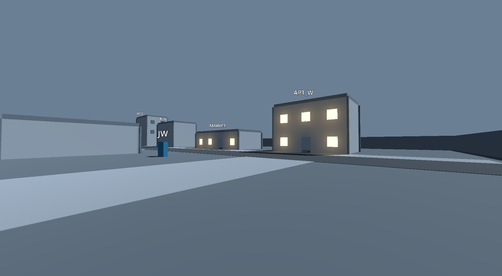
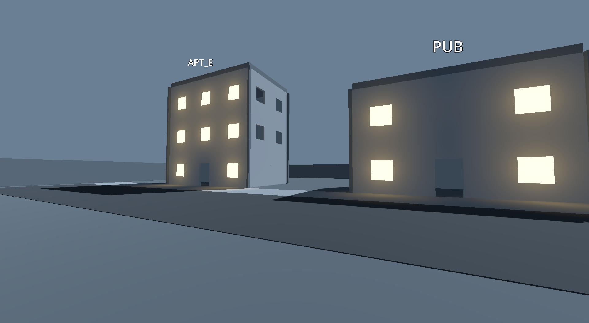
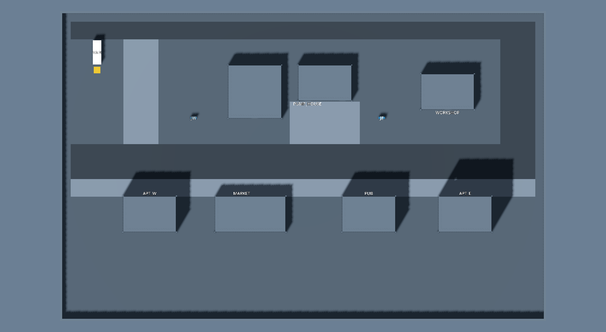

# Evidence: V01 Graybox Alder Street

- Status claimed: CLOUD_VERIFIED (ADR-015 ceiling: G08 is not DONE; the person-with-a-controller traversal and the owner's look are pending)
- Date (UTC): 2026-10-30
- Branch / commit: `claude/V01-graybox-alder-street`, cut from `main` at cbd14a2 (see PR)
- Environment: local desktop session on the owner's Windows 11 laptop, NVIDIA GeForce GTX 1650 (driver 595.79, OpenGL 3.3), Git Bash
- Engine: Godot 4.7.2.stable.official.ed1daf0bf, Compatibility renderer, default 3D physics engine (project setting unset).
  No font, model, image or third-party asset added: every mesh is a Godot primitive or an F05 kit scene; labels use the engine's built-in font.
- Content revision: `content/world/alder_street.json` (new), `content/contracts/c01_alder_street/equipment.json` anchors moved.

## Acceptance criterion (copied from docs/backlog.json)
> All routes traversable solo/controller; first restoration visible from the van.

## What was built
- `content/world/alder_street.json`: the layout as data, in integer cm. It holds the 110 m x 70 m envelope, ground and basement pit, six
  circulation routes, the street loop, seven buildings (the six services plus one non-service filler), kit placements (basement stair, pit
  rails), props (van, JW/JE cabinets, pump unit, three pads, flood water), markers, the `ZONE_VAN` zone, the JW/JE/VAN labels and two sightlines.
- `scripts/world/district_builder.gd`: data to scene. Facades are instances of the F05 kit scenes, one piece per 4 m module per storey,
  with corner posts, roof planes and roof edges. It also has `describe()` for the drift check.
- `scripts/world/scene_writer.gd`: deterministic saving, shared by both generators. It keeps the scene UID and derives node `unique_id`s and
  `ext_resource` ids from names. The F05 generator now uses it too. Rerunning it left all 11 kit scenes byte-identical (`git status` clean).
- `tools/godot/build_district.gd` writes `scenes/world/alder_street.tscn` (1931 lines). Two runs give the same md5.
- `tools/godot/capture_district_views.gd` renders on the real GPU: one view per sightline from the eye marker, plus a top-down plan.
- `tests/support/district_probe.gd` and `tests/unit/test_V01_alder_street.gd` hold the 11 V01 tests (below).
- `content/world/kit_dimensions.json` adds the player body: capsule radius 35 cm, height 180 cm, floor angle 45 deg, and a 30 cm nav step.
  These are design choices for the CharacterBody3D, not measurements.
- `tests/run_tests.gd` now awaits one frame before running. In `_initialize` the root window is not in the tree yet, so it has no World3D.
  The V01 scene tests need the physics world. Nothing else changes.

### Layout (blueprint p.5-6 centers, all within 0 cm of the table)
| Location | Blueprint (x, z) m | Graybox | Notes |
|---|---|---|---|
| Van / spawn | (8, 9) | van box 2 x 5.5 m centered (8, 9) | VAN_BAY pad at (8, 13); 4 spawns; `ZONE_VAN` x 3-13, z 4-20 |
| JW | (30, 24) | cabinet 1.5 x 1.75 x 0.5 m | PANEL_JW and SW_JW_BREAKER on its north face at 1.40 m; label "JW" |
| APT_W | (20, 46) | 12 x 8 m, 2 storeys | front (south) faces the main street |
| MARKET | (43, 46) | 16 x 8 m, 1 storey | |
| PUB | (70, 46) | 12 x 8 m, 2 storeys | SW_SIGN at 1.40 m on the front; SIGN above the door |
| APT_E | (92, 46) | 12 x 8 m, 3 storeys | |
| WORKSHOP | (88, 18) | 12 x 8 m, 1 storey | front door to the main street, back door to the rear service alley |
| PUMP_HOUSE | (60, 16) | 12 x 8 m, 1 storey, walkable interior | stair door, then a 2.5 m stair down to a 2 m basement pit (pump, TRUNK_JE); bay door, then PAD_PUMP and STORE_PUMP_HOUSE |
| JE | (73, 24) | cabinet as JW | PANEL_JE, SW_JE_BREAKER; label "JE" |

Routes: MAIN_STREET (8 m), SIDEWALK_NORTH (4 m), REAR_ALLEY (4 m, south edge), WEST_LINK (8 m, through the van yard), EAST_LINK (8 m),
PUMP_FORECOURT (9.75 m). The loop runs REAR_ALLEY, EAST_LINK, MAIN_STREET, WEST_LINK and back. The two broad sightlines are the open van yard
(van to APT_W/MARKET) and the main street (JE to PUB/APT_E).

### Collision (blueprint p.6 "simplified convex geometry")
- A 'block' building is one box. Its kit instances have `collision_layer = 0`, so corner posts, sills and roof edges cannot snag a player.
  A player brushing a corner clips through the 25 cm visual post instead.
- Only the pump house ('kit' collision, because its interior is walkable) keeps the kit pieces' boxes. The stair collides as one ramp
  (F05 wedge). The pit rails are one box each.
- Props are single boxes. Pads, paving and flood water are visual only, so a 2 cm kerb never becomes a ledge.
- Every CollisionShape3D in the scene is a BoxShape3D except the stair ramp (`test_V01_collision_is_simplified_convex_geometry`).

## What was run
```
G=/c/Tools/Godot/Godot_v4.7.2-stable_win64_console.exe
"$G" --headless --path . -s "$PWD/tools/godot/build_blockout_kit.gd"      # 11 x WROTE, kit files unchanged
"$G" --headless --path . -s "$PWD/tools/godot/build_district.gd"          # WROTE; rerun -> same md5
"$G" --path . --resolution 1920x1080 -s "$PWD/tools/godot/capture_district_views.gd" -- --out-dir=build/v01
bash tools/run_tests.sh
```
Negative controls (both reverted, scene regenerated, `git status` clean afterwards):
1. APT_W storeys 2 to 3 in the data without regenerating: `test_V01_committed_scene_matches_the_data` FAILS (node count 390 vs 404).
2. A 8 m x 4 m wall prop across the van yard, regenerated: the WEST_LINK clearance check fails, and so do both van sightlines
   ("VAN_EYE -> APT_W window ... blocked by Props/BLOCKER"). The walk test still passed: the body walked around the wall, as it should.
3. Walker without the tick scaling described below: `test_V01_walker_moves_at_the_content_walk_speed` FAILS
   ("1 s of walking took 15 physics ticks (want about 60)").

**Found while testing:** outside a physics frame, `CharacterBody3D.move_and_slide()` integrates over the *process* frame delta. In the
test runner that delta is however long the first frame took, 146 ms on one cold start. The first walk test passed twice, then failed
four runs in a row: each call moved 0.59 m and the body circled its 0.5 m waypoints. `district_probe.gd` now scales the velocity by
physics tick / process delta, so each call moves exactly one 60 Hz tick, and a regression test pins it. Whoever writes the real player
controller should keep its `move_and_slide` calls inside `_physics_process`.

Before writing the walk test, a throwaway probe (deleted, not committed) checked the walker. A body driven straight at APT_W stops at
z = 41.64, the facade at 42 minus the 0.35 m radius. One driven into the pump-house window wall stops at z = 20.35. One sent down the
basement stair ends on the pit floor at y = -2.00. The 50 cm grid builds in 1.3 s: 26 644 of 30 800 cells are standable, and 26 640 of
them are reached from SPAWN_1.

## Observed result
- `bash tools/run_tests.sh` (run twice, both identical): backlog valid, `content: 19 JSON files, 0 errors`, contrast OK, reference tests OK,
  Godot `tests: 191 passed, 0 failed, 4558 assertions`, `SOLVED C01 in 316 ticks (56 steps)`, cross-check MATCH, `ALL CHECKS PASSED`.
- `tests/unit/test_V01_alder_street.gd`: 11 of 11 PASS, in about 8 s for the file.
  - `committed_scene_matches_the_data`: the scene was regenerated from the data and its recursive description is identical.
  - `locations_sit_at_their_blueprint_centers`: the six services, the JW/JE cabinets and the van each sit at their blueprint center
    (tolerance 200 cm, actual 0). JW and JE are labelled.
  - `layout_uses_the_4m_module_and_25cm_increment_inside_the_envelope`: every building size is a multiple of 400 cm, and every corner,
    route, prop, kit placement and the pit sits on the 25 cm grid. Each face has one piece per module, everything is inside 110 x 70 m,
    and the ground slabs tile the envelope exactly.
  - `circulation_is_at_least_2_4m_wide_and_clear`: the routes are 400-975 cm wide (minimum 240) and no collider sits in any route
    volume up to 2.1 m. The basement stair is 250 cm wide.
  - `panels_and_switches_sit_at_interaction_height`: PANEL_JW/JE, SW_JW/JE_BREAKER, SW_SIGN and TRUNK_JE are all at 140 cm above the floor
    measured under them (range 120-160).
  - `every_c01_target_is_reached_on_foot_from_the_van`: 23 targets. They are 6 route centers, 6 service entrances, 3 anchors
    (VAN_BAY, PAD_PUMP, STORE_PUMP_HOUSE), 6 panels or switches (TRUNK_JE included), and the SIGN and PUMP consumers. For each one a grid path from SPAWN_1
    is walked by a CharacterBody3D (capsule 0.35 x 1.8 m, floor angle 45 deg, gravity) at `walk_mm_s` = 4.0 m/s with `move_and_slide`.
    Each walk ends within 0.3 m of its goal, including PUMP and TRUNK_JE, 2 m down in the basement.
  - `walker_moves_at_the_content_walk_speed`: one second of walking takes 60 physics ticks (tolerance 3) and arrives.
  - `rear_loop_walks_all_the_way_round`: REAR_ALLEY, EAST_LINK, MAIN_STREET, WEST_LINK, REAR_ALLEY, walked leg by leg.
  - `first_restoration_is_visible_from_the_van_and_east_from_JE`: physics rays from VAN_EYE (1.75 m above its floor) reach every
    ground-floor front window of APT_W and MARKET, the west branch restored first (p.7 step 1). Rays from JE_EYE reach PUB and APT_E.
    The rays test against collision, which is conservative because a block building is solid.
  - `collision_is_simplified_convex_geometry` (above), and `c01_anchors_and_van_zone_match_the_graybox`. In that test, every
    `equipment.json` anchor equals the graybox marker of the same ID, and every C01 switch and repair panel has a marker. `ZONE_VAN` is an
    Area3D that contains the four spawns and VAN_BAY.
- C01 anchors moved: VAN_BAY (1000, 0, 2000) to (800, 0, 1300); STORE_PUMP_HOUSE (5800, 0, 1500) to (6450, 0, 1350);
  PAD_PUMP (6000, 0, 1600) to (6250, 0, 1600). The IDs did not change. `test_V03_recovery_routes.gd` positions follow the new anchors.
  The solution trace uses anchor IDs only, and `validate_solution.gd` still SOLVES C01.
- Renders: `WROTE build/v01/V01_VAN_EYE.png (1920x1055, NVIDIA GeForce GTX 1650)`, and the same for `V01_JE_EYE.png` and `V01_plan.png`.
  They are copied to `docs/evidence/img/`. The warm windows are drawn by the capture tool only, to stand in for the restored state;
  the graybox scene has no lighting states yet.

From the van, at eye height 1.75 m with a 75 deg FOV, APT_W and MARKET are restored:


From JE, PUB and APT_E across the main street:


Plan, top-down orthographic, x to the right and z down the image:


## Layout interpretations for the owner to confirm
1. **Rear service alley on the south edge**, behind the pump house and workshop. The blueprint calls the workshop the "service alley
   landmark". The loop is main street, east link, rear alley and van yard. The service row (z 46) has open back yards, not a second lane.
2. **The basement is a 2 m pit inside a double-height pump house**, with no slab over it, reached by the F05 stair. The flood is a visual
   box (`FLOOD_WATER`) that presentation will drive from the water scalar. Access stays a mission predicate (PUMP_HOUSE_DRAINED).
3. **`TRUNK_JE` is a graybox work point**, not a content ID. P.7 says the pump exposes the east trunk, so it sits on the pit wall.
   `repairs.json` still names `PANEL_JE` (at the JE cabinet) as the R_JE_TRUNK panel. Binding the repair steps to world targets is G04/V07
   presentation work.
4. **Handedness.** Godot is right-handed with Y up, so a player facing +z (north in the blueprint table) has +x (east) on the left. The
   positions match the table exactly. A map UI (V07) must draw z downward, as `V01_plan.png` does, or mirror one axis.
5. **`SOUTH_FILLER`** (x 38-50, z 12-24) is a non-service facade so the south side reads as a street. It has no content ID.

## Not verified / pending_local
- **UX01: no person has walked these routes with a controller.** The automated walk drives a CharacterBody3D with
  keyboard-equivalent velocities. It proves collision and reachability, not feel, camera, or controller deadzones. No player controller
  scene exists yet (V05 has the deterministic movement step without collision).
- **G08 (grid toy gate) is not DONE.** ADR-015 allows this prep work but caps V01 at CLOUD_VERIFIED. Reach and collision may change after
  the two-player toy.
- **The owner's look at the graybox**, including the five interpretations above.
- No performance number. The graybox was not profiled; P95 frame time comes from an exported build later.
- Block-building doors lead nowhere (facades only). Only the pump house has an interior, which C01 needs. C01 has no ladder; the fixed
  ladder (an interaction transition, not physics) comes with C03's roof route.
- Jumping, crouch clearance and the carry speed with the generator were not walked.

## Resume notes (for the next session)
Everything is committed on `claude/V01-graybox-alder-street`. To change the layout, edit `content/world/alder_street.json`, rerun
`tools/godot/build_district.gd`, then the tests and the capture tool. The next V01 steps need a person: the owner reviews the renders and
the interpretations, and a controller traversal (UX01) runs once a player controller scene exists (V05/V07). G04 and G05 can now bind
prompts and cable visuals to the markers in `scenes/world/alder_street.tscn` (stable paths `Markers/<ID>`).
