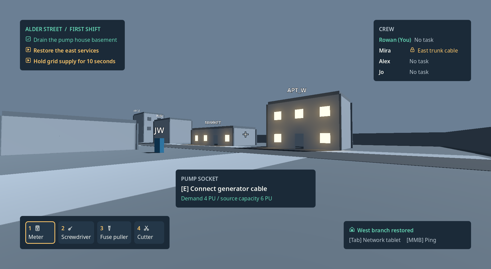
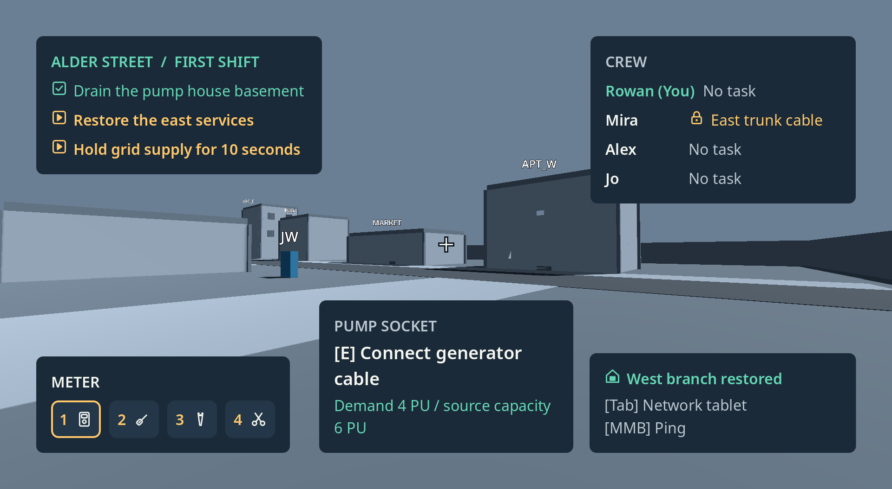
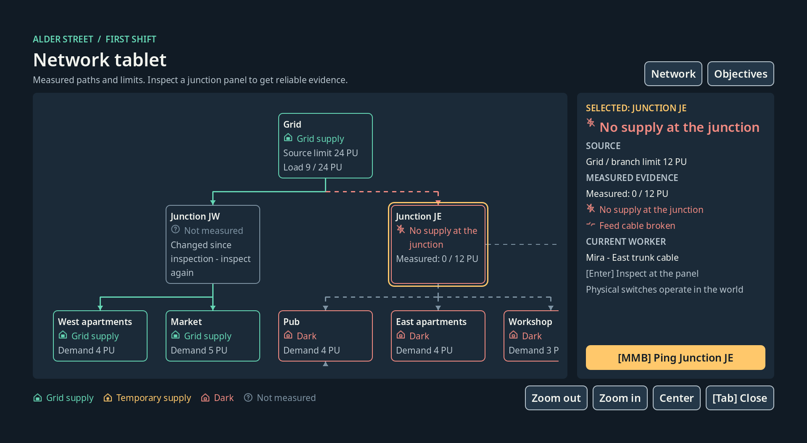
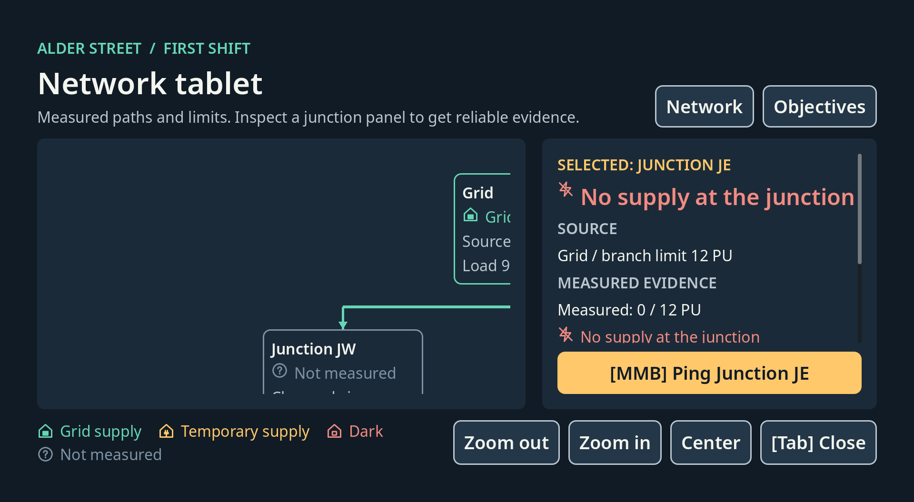
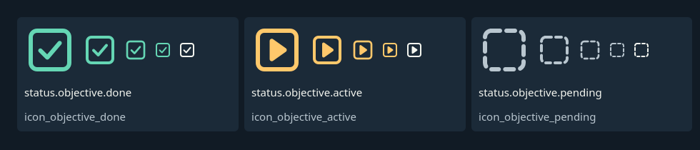

# Evidence: V07 Produce field and tablet UI

- Status claimed: **CLOUD_VERIFIED** (local desktop session, ADR-015). V01 is CLOUD_VERIFIED, and the UX items need a person with a real
  controller, so V07 cannot be DONE yet.
- Date (UTC): 2026-10-30
- Branch / commit: `claude/v07-field-tablet-ui-82e535`, cut from `origin/main` at 9a94382 (contains V01, F05 icons, font and kit, PR #31).
  The commit is the head of the V07 PR.
- Environment: local, owner's Windows 11 laptop. NVIDIA GeForce GTX 1650, driver 595.79, OpenGL 3.3 Compatibility renderer.
- Engine: Godot 4.7.2.stable.official (ed1daf0bf). No extensions involved.
- Content revision / protocol / save schema: unchanged (protocol 1). The UI adds content files only (strings, tablet layout, three icons).

## Acceptance criterion (docs/backlog.json)
> Map inspects and pings only; controller focus complete; 150% scale usable.

Steps: "Build containers, context prompt, tool bar, crew list, graph navigation, icons and focus."

## What was built
| File | What it does |
|---|---|
| `scripts/ui/field_hud.gd`, `scenes/ui/field_hud.tscn` | S06 field HUD. Objective card top-left (at most 3 rows), crew top-right, reticle, prompt below it, tools and carried equipment bottom-left, latest event and Map/Ping hints bottom-right, inside the 80 px safe area. Never takes focus, sends nothing. |
| `scripts/ui/hud_presenter.gd` | Builds the HUD view from authoritative state: mission objective rows, crew with repair locks and carried items, loadout. No grid values. |
| `scripts/ui/network_tablet.gd`, `scenes/ui/network_tablet.tscn` | S07 tablet: header with Network / Objectives tabs, map, evidence panel with Ping, legend, zoom, center, Close. |
| `scripts/ui/tablet_map.gd`, `tablet_node.gd` | Directed map from `grid.json` on the authored `tablet.json` grid. Solid teal/amber edges when energized, dashed coral when a meter measured the feed broken, dashed gray-blue when unknown. Adjacency focus, pan, zoom. |
| `scripts/ui/tablet_presenter.gd` | Tablet view from content plus what the player can know: lit buildings, current meter snapshots only. |
| `scripts/ui/intent_outbox.gd` | Builds ADR-009 envelopes and hands bytes to the transport / `session_host.receive`. Per-view gates; the tablet's allows `inspect` and `ping` only. |
| `scripts/ui/status_chip.gd` | Icon + text in the token color from `status_states.json`; used for every status. |
| `scripts/ui/ui_text.gd`, `content/ui/strings/en.json` | Localization keys, English strings, 35 % pseudo-locale, binding labels from the live InputMap (keyboard/mouse or controller). |
| `scripts/ui/theme_tokens.gd` | Theme at the effective UI scale. Primary/secondary buttons (56 px), 3 px focus ring 4 px outside, opaque panels. |
| `scripts/ui/focus_scroll.gd`, `reticle.gd` | Controller-scrollable evidence panel with a visible bar; two-tone reticle. |
| `content/contracts/c01_alder_street/tablet.json` | Map cell and name key of every C01 grid node. |
| `art_source/ui_icons/icon_objective_*.svg` + exports | Objective done / current / later icons (ADR-004 V07 addendum point 1). |
| `tools/godot/generate_input_map.gd` | `ui_accept` + A and `ui_cancel` + B (Godot's defaults have no controller button); `project.godot` regenerated. |
| `tools/godot/capture_hud.gd` | GPU capture plus rendered-contrast measurement. |
| `tools/godot/capture_icon_sheet.gd` | Gains `--only=<group>`. |

Decisions are recorded in the ADR-004 addendum "V07". The UI never changes simulation state: views read presenter output, and the only way to
act is the outbox, the same command path as remote players.

## What was run
```
git fetch origin && git merge --ff-only origin/main             # 9a94382
godot --headless --path . -s "$PWD/tools/godot/generate_input_map.gd"
godot --headless --path . -s "$PWD/tools/godot/export_icons.gd"  # 9 wrote, 108 unchanged
bash tools/run_tests.sh                                          # full suite
/c/Tools/Godot/Godot_v4.7.2-stable_win64_console.exe --path . --resolution 1920x1080 -s "$PWD/tools/godot/capture_hud.gd" -- --out-dir=build/v07
/c/Tools/Godot/Godot_v4.7.2-stable_win64_console.exe --path . --resolution 1920x1080 -s "$PWD/tools/godot/capture_icon_sheet.gd" -- --out=build/v07/V07_objective_icons_full.png --only=objectives
```
The window's client area on this laptop is 1920x1055, not 1080 (the screen limits the window). The captures and the contrast report are at
1920x1055, which is an effective UI scale of 97.7 % / 146.6 %. The exact 1920x1080, 1280x720 and 1920x1200 layouts are covered by the headless tests.

## Observed result
`tests/unit/test_V07_ui.gd`: 14 tests, all PASS. The full suite passes (`ALL CHECKS PASSED`): backlog check, Python reference, every Godot test,
C01 solution trace, and the Python/Godot cross-check.

| Acceptance | Test | Result |
|---|---|---|
| Map inspects and pings only | `test_V07_map_sends_only_inspect_and_ping_and_never_changes_the_network` | PASS. The tablet is wired to a real C01 host mid-shift. Every node gets Accept and a click, every button is pressed, every InputMap action is fed to the tablet. Only `inspect` and `ping` envelopes are sent; grid, repairs, equipment, mission and crew state serialize byte-identical before and after. The gate refuses `toggle_switch` before sending. |
| | `test_V07_inspect_goes_through_the_host_and_its_answer_is_shown` | PASS: a node inspects its own meter panel through the host; a building without a panel sends nothing. |
| Controller focus complete | `test_V07_directional_focus_reaches_every_control_from_every_control` | PASS at 1920x1080 and 1280x720, 100 % and 150 %, Network and Objectives tabs. Built from `find_valid_focus_neighbor` in 4 directions (stick/D-pad only): every control has a way out, and from every control every other is reachable. Every target is >= 48 px at the effective scale. |
| | `test_V07_opening_moves_focus_in_and_closing_restores_it` | PASS: open focuses the selected node; B/Esc and Tab close and restore the previous control. |
| | `test_V07_controller_bindings_show_the_device_and_follow_remapping` | PASS: E/A, MMB/LB, A = Accept, B = Back; a remapped key shows its new label. |
| 150 % usable | `test_V07_hud_fits_the_safe_area_at_every_size_scale_and_locale` | PASS for 3 sizes x 80/100/150 % x English/pseudo on the worst-case HUD (3 objectives, 4 busy crew, 5 tools, carried item, prompt with a missing condition). Regions stay in the safe area, never overlap each other or the reticle, the prompt is below the reticle, no control spills out of its parent, no label is squeezed or hides lines. |
| | `test_V07_tablet_fits_and_every_node_scrolls_fully_into_view` | PASS for the same 18 combinations. Nothing outside the map and the evidence scroll spills. Long evidence shows a scroll bar and Ping is always on screen. Every map node scrolls fully into view when focused. |
| Layout = reference p.42 | `test_V07_hud_follows_the_reference_layout_at_100_percent` | PASS: objective card at (80, 80), 420 px wide; crew right edge 1840; reticle (960, 540); prompt at (680, 680), 560 px; tools and event on the bottom safe line. |
| Icon + text + token | `test_V07_every_status_widget_is_icon_text_and_token_color` | PASS: every chip in HUD and tablet at 150 % has non-empty text and its own icon at the scale's export, both in the state's token color. |
| Measured only (S07) | `test_V07_tablet_shows_measured_values_only` | PASS. JE shows Mira's measurement (no supply, feed broken) and her lock; TEMP is unknown; JW says inspect again; the broken trunk edge is coral only because it was measured; the unmeasured TEMP->PUB route is gray. |
| Localization | `test_V07_every_content_text_key_has_english_text`, `test_V07_pseudo_locale_is_35_percent_longer_and_keeps_placeholders` | PASS. |

F05 tests updated for the three new icons: the icon count is 39, and the objective icons equal `mission_director` statuses. Both PASS.

### Rendered contrast on the real GPU (closes F05)
`capture_hud.gd` draws each view twice. Frame A is what the player sees. Frame B hides only the ink (label text, icons, reticle, map edges),
so B holds the real pixels behind every glyph. Each probe compares its token color with every B pixel in its visible rect (clipped by scroll
panels and the map) and keeps the worst. Minimums: 4.5:1 body, 3:1 large text (>= 24 px), icons, the two-tone reticle and the map edges.

```
hud_dark_100: 37 probes, worst margin x1.78 of the AA minimum
hud_dark_150: 34 probes, worst margin x2.22 of the AA minimum
hud_restored_100: 37 probes, worst margin x1.78 of the AA minimum
hud_restored_150: 34 probes, worst margin x2.22 of the AA minimum
tablet_100: 70 probes, worst margin x1.02 of the AA minimum
tablet_150: 40 probes, worst margin x1.53 of the AA minimum
CONTRAST PASS: 252 probes, 0 below AA (NVIDIA GeForce GTX 1650)
```
The tightest probe is "Not measured" in `unknown` (#7E93A3) on the panel: 4.59:1, within the F05 contrast addendum (body text allowed on the
panel, not on the elevated panel). The reticle is the only HUD element drawn straight over the scene, and it passes 3:1 against every scene
pixel behind it in both lightings. Full report: [V07_contrast.json](V07_contrast.json).

### Screenshots (GTX 1650, 1920x1055)
HUD over the graybox from the van eye, restored west windows, 100 % and 150 %:


Dark lighting at 100 % and restored at 150 % are `img/V07_hud_dark_100.png` and `img/V07_hud_restored_150.png`.
Network tablet, junction JE selected (Mira's measurement), 100 % and 150 %:


New objective icons for the owner's review:


The capture's warm windows are the same stand-in as V01's (capture tool only); no presentation layer drives window states yet.

## Owner decision (30 Oct 2026)
The owner deferred the review items and provisionally approved them: "they can be reviewed later. Consider approved for now." That covers
the three objective icons and the 150 % readability judgement (compact tool bar, prompt width, tablet default zoom). Both stay listed as
delayed human reviews in `docs/PC-WORK.md` section 5 until the owner has looked. UX01 is a test run, not a judgement, so it stays pending.
Status stays CLOUD_VERIFIED: V01 (dependency) is CLOUD_VERIFIED, and UX01 needs a person.

## Not verified / pending_local
- **UX01 (human controller run):** a person pressing a real controller through the HUD and tablet. The focus graph is proven from Godot's own
  neighbour search, not from button presses. Feel of the stick focus, pan and zoom speeds, and whether D-pad scrolling of the evidence
  panel feels right are not judged.
- **Readability judgement** (provisionally approved, look deferred: PC-WORK.md section 5): whether 150 % reads well from the couch, whether the
  compact tool bar is clear enough, and whether the tablet's default zoom is right (it opens at full text size and pans).
- **Owner look at the three new objective icons** (provisionally approved, look deferred: PC-WORK.md section 5).
- Simplified Chinese (needs Noto Sans SC, owner go-ahead) and 21:9 bounded UI were not tested. 16:9 and 16:10 were.
- The HUD is not yet wired into a running mission scene (MissionRoot / player controller do not exist yet). The capture fed it a real host
  state from the C01 solution trace. Prompt text comes from the caller; choosing the prompt from the looked-at target belongs to the player
  controller / interaction work.
- Toasts (max two, timing), the first-minute binding introduction and teammate name tags (S06) are not built.
- Controller glyph images: bindings are text labels.
- No performance measurement: the UI was not profiled in an exported build.

## Resume notes (for the next session)
- V07 is merged (PR #32, aa35df7) and finalized (owner's provisional approval recorded, follow-up PR). Nothing is half-done.
- Next steps for a person: UX01 with a controller; the deferred looks in `docs/PC-WORK.md` section 5.
- Next backlog task (`backlog.py next --env local`): **A04** Create onboarding and core accessibility.
- Next steps for code: wire `field_hud.tscn` / `network_tablet.tscn` into MissionRoot with a live presenter feed, and add toasts.
